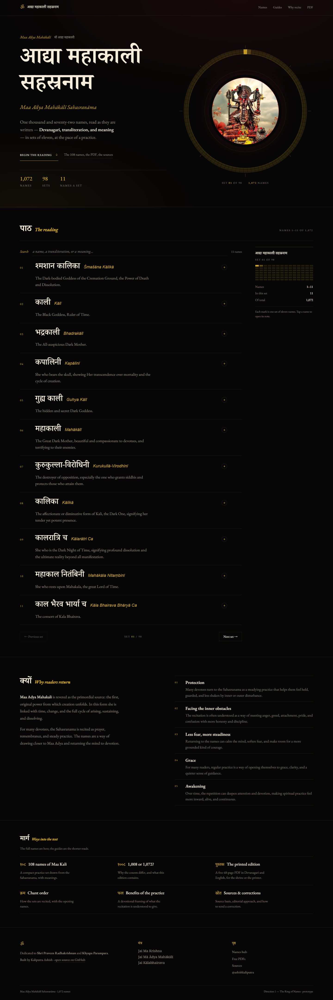
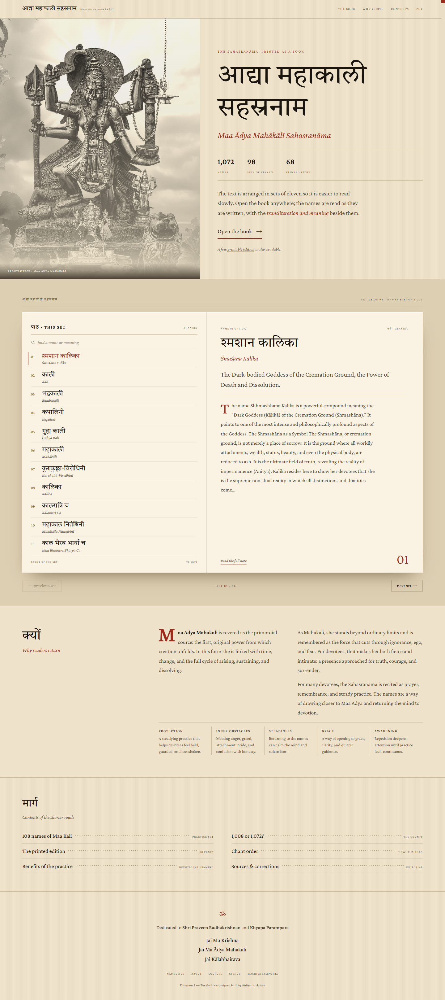
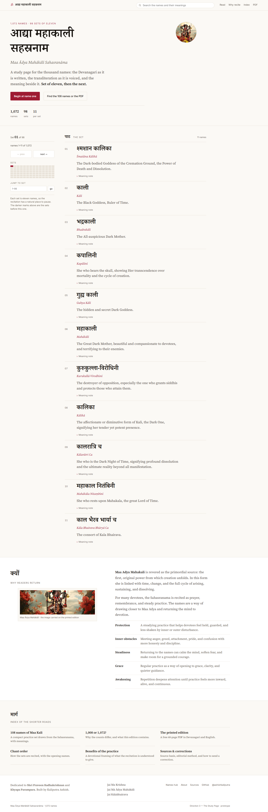

# Redesign proposal — Maa Ādya Mahākālī Sahasranāma

Prepared 2026-11-13 · review of the live site + three built directions
Files: `review.md` (critique), `directions.md` (six candidates), `polish-log.md` (craft rounds),
`dir-1.html` · `dir-2.html` · `dir-3.html` (working prototypes), `review/*.png` (screenshots).

---

## 1. The review in one paragraph

The content is extraordinary — 1,072 names with Devanagari, IAST, meanings, elaborations, a printed
edition and a source note — and the pages that carry it (`/names/kali/`, the 108-names guide) already
look like a book. The homepage does not. It is a generic landing page: full-bleed photo with four
competing links on it, eleven identical rounded cards whose meaning is hidden behind a "Read More"
bar, emoji icons, gradient glows, uppercase micro-labels, and a second design system that starts the
moment you leave the homepage. The names — the only thing here no template can fake — appear as
all-caps ASCII (`SHHMASHHANA KALIKA`) while the actual Devanagari and IAST sit unused in the build.
**Score 5.2/10**, concept-led: the "midnight shrine" idea exists in the palette but not in the
structure. Full detail and measured evidence in `review.md`.

## 2. What the redesign has to do

1. Put **name + Devanagari + IAST + meaning** in one glance, eleven at a time.
2. Make **the set of eleven** visible as structure, not just a Next button.
3. **One system** for the reader and the 1,039 reference pages.
4. Use the photograph as a **sacred object**, never as wallpaper behind type.
5. Stay legible for long phone sessions: body ≥16px, every active text ≥4.5:1, no emoji.

All three directions below do all five. They differ in temperature and skeleton, not in scope.

---

## 3. The three directions

### Direction 1 · The Ring of Names — `dir-1.html`
*Best designer: 杉浦康平 (Kohei Sugiura) — information mandalas.*

- **The idea:** 1,072 names is 97 sets of eleven plus five; the text is recited in a cycle, so the
  structure is a **ring**, not a scrollbar. Deep black, gold hairlines, one crimson aperture holding
  the photograph. The reading column keeps Devanagari, IAST and meaning in one line of sight.
- **Signature:** 98 real arcs — the current set lit, earlier sets dimmed, tapping an arc moves the
  reading. A companion 98-mark matrix sits beside the column on desktop.
- **Feels:** ceremonial, nocturnal, precise. The most distinctive of the three.
- **Risk:** dark for long sessions; the ring must stay functional (it does) or it becomes ornament.
- **Best if:** you want the site to be remembered, and you accept a darker reading surface.

### Direction 2 · The Pothi — `dir-2.html`
*Best designer: Irma Boom — the book as an object.*

- **The idea:** the site already exists as a 68-page printed PDF; make the web version **the same
  book**. Warm paper, a duotone frontispiece, a real two-leaf spread with a gutter, running heads,
  folio numerals, and a **fore-edge strip of 98 coloured bands** as the progress device.
- **Signature:** the left leaf is the set of eleven, the right leaf is the current name; clicking a
  name turns the page. On mobile the spread becomes a thumb index of eleven numbered tabs.
- **Feels:** reverent, warm, printed. Closest to the pages you already have, so the site finally
  reads as one book.
- **Risk:** a literal book metaphor needs restraint; the warmth has to be kept (paper, ink) rather
  than decorated (vintage textures).
- **Best if:** you want the landing page to feel like the rest of the site and like the PDF.

### Direction 3 · The Study Page — `dir-3.html`
*Reality reference: Sefaria's bilingual reader.*

- **The idea:** a text you return to needs a tool, not a poster. Warm-white ground, a 760px measure,
  a number rail, hairline segments, one quiet sticky bar for search and the set.
- **Signature:** each name is a segment — Devanagari, IAST, meaning, then an inline note that opens
  underneath. Search is accent-insensitive (`kali` finds `Kālī`). The photo appears once, small, as a
  seal, and once as a plaque beside the dedication.
- **Feels:** calm, modern, legible. The safest and the fastest to read.
- **Risk:** least atmospheric; the Devanagari has to carry the identity on its own (it can).
- **Best if:** search traffic, accessibility and reading comfort come first.

---

## 4. Recommendation

**Direction 2 as the system, with Direction 3's reader mechanics folded in.**

- Direction 2 is the only one that resolves the site's actual problem — two design systems — because
  the paper-on-temple world is already what your best pages use. It also ties the site to the printed
  edition, which is a real object your readers already have in hand.
- Direction 3 contributes the mechanics that make long-session reading work: the sticky set bar, the
  accent-insensitive search, the inline note.
- Keep Direction 1's ring for **one** surface — the printed-edition page or the 1,072 index — where a
  circular map of the whole text earns its place without competing with the reading.

If you prefer a single direction untouched, pick **2** for soul, **3** for utility, **1** for memorability.

## 5. What implementation looks like

**Data (the key fix, and it is cheap).** The Devanagari and IAST already exist at build time in
`src/data/name-mapping.json`, keyed by number. The reader currently ships only
`english_name / english_one_line / english_elaboration` from `public/data_chunk_*.json`. Rendering the
first set of eleven server-side from the mapping (Astro can, it is static) puts the sacred text on
the page with **no extra network cost**; the chunks stay for the rest.

**Structure.** `src/pages/index.astro` becomes four blocks: entry · reader (server-rendered set of 11)
· why · ways in. The client script keeps search, set paging and the note disclosure — about a third of
today's `app.js`.

**Design tokens.** One stylesheet, replacing the split between `styles.css` and `reference.css`:
paper `#faf3e3`, ink `#1b1510`, cinnabar `#9c2b1c` (text-safe on paper and on the desk ground),
desk `#ddcfb2`, rule `#cdbc9c`; Crimson Pro + Tiro Devanagari Sanskrit (both on Google Fonts, both
already close to the sister site's Crimson Text + Philosopher).

**Content QA (must do before launch).** The ASCII spellings that open the elaborations
("Shhmashhana Kalika", "Kurukulla-'Virodhini", "Kala Ratri Cha") and the doubled letters in the site
spelling are content bugs, not design bugs; once the reader shows IAST, they become visible
contradictions. Re-transliterate the opening line of each elaboration from `iast`, keep the prose.

**Keep untouched:** the 1,039 name pages, the 108 / 1008 guides, the PDF pipeline, the sitemap, the
FAQ content, the structured data, the analytics, the service worker. This is a homepage/reader and
stylesheet change, not a rebuild.

**Effort:** one direction, built and polished to this prototype's standard — 2–3 days; plus the
content pass; plus the reference-page restyle if you want the whole site on one system (a token swap
on `reference.css`, half a day).

## 5b. Phone behaviour (verified)

All three were tested at **320 · 360 · 375 · 390 · 414 · 768 px**: no horizontal scroll, no clipped
text, no console errors, body 16.5–17.5px, active text ≥4.5:1, and expand / search / set navigation
all working with touch. Screenshots: `review/mobile-board.png`, `review/m-view-d*.png`.

- **01 Ring** — the 98-arc ring shrinks to 250px above the title; the aside matrix is hidden and the
  reading column gets the full width, with prev/next and the set counter under it.
- **02 Pothi** — the desktop spread collapses to a **two-column set index** (all eleven names, search +
  match count) above a single reading page; the fore-edge strip is dropped. Tapping a name turns the
  page and brings it into view.
- **03 Study** — the number rail is replaced by a **fixed bottom set bar**, the search moves to a
  full-width row under the brand, and the header stops being sticky so it does not eat the screen.

One production caveat: the prototypes hold 22 names (two sets) so the index and search can be felt
end-to-end. In production the index/search must span all 1,072 names — search hits open the right set,
and the set bar pages through 98 sets, not two.

## 6. Still on the table

Directions 4 (Darshan, full-bleed photography), 5 (Name Gallery, Kenya Hara white) and 6 (Practice
Index, dense magazine) are drawn as thumbnails in `thumbs.html` and were not built out. Darshan is
the strongest of the three if you want an image-led landing page; say the word and I will build it.
